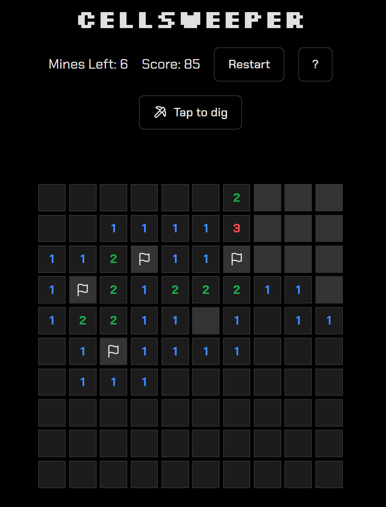

# CellSweeper

CellSweeper is a classic Minesweeper-like game implemented using Next.js and TypeScript. It also uses the beautiful components provided by the `shadcn/ui` library.

## Live Demo

Play it now: [https://cellsweeper-nextjs.vercel.app](https://cellsweeper-nextjs.vercel.app)

## Screenshot



## Features

*   **Classic Minesweeper Gameplay:** Enjoy the familiar gameplay of revealing cells and avoiding mines.
*   **Random Mine Placement:** Each game generates a new 10x10 grid with 10 mines in random locations. Both are set by the `N` constant in `src/app/page.tsx`.
*   **Touch Friendly:** Flag cells with a long press, or switch the tap mode between dig and flag, so the game is fully playable on phones and tablets.
*   **How to Play Help:** A `?` button opens a quick guide to the rules and controls.
*   **Dark Mode Support:** Follows your system colour scheme by default, with a switch in the top-right corner to choose light or dark.
*   **Responsive Design:** The game adapts to different screen sizes, providing a consistent experience across devices.
*   **Clear Visual Feedback:** Cells clearly indicate whether they are hidden, revealed, or flagged.
*   **Win/Lose States:** The game clearly shows whether you won or lost.
*   **Restart Button:** Easily restart the game to play again.
*   **Mines Left Counter:** You can easily see how many mines are left.
*   **Score Counter:** You can see the current score of the game.

## Technologies Used

*   **Next.js 15:** A React framework for building fast and scalable web applications.
*   **TypeScript:** A statically typed superset of JavaScript that enhances code quality and maintainability.
*   **Tailwind CSS:** Utility-first CSS used for all styling.
*   **shadcn/ui:** A beautiful library of reusable UI components that follow modern design principles.
*   **lucide-react:** A simple icon library.
*   **next-themes:** A library to easily implement the dark mode in the project.

## Getting Started

1.  **Clone this repository:**

    ```bash
    git clone https://github.com/fancellu/cellsweeper-nextjs.git
    ```

2.  **Install dependencies:**

    ```bash
    npm install
    ```

3.  **Start the development server:**

    ```bash
    npm run dev
    ```

4.  **Open your browser and go to `http://localhost:9002` to play the game.**

### Useful Scripts

*   `npm run check`: Type-check and lint the code. This is safe to run while the dev server is running.
*   `npm run build`: Create a production build. Stop the dev server first, because both use the `.next` folder.
*   `npm run clean`: Delete the `.next` folder. Use this if the dev server starts reporting missing manifest files.

## How to Play

*   **Dig:** Click or tap a cell to reveal it. If it's a mine, you lose! A number shows how many of the 8 surrounding cells contain mines. If there are none, the surrounding cells are revealed automatically.
*   **Flag:** Right-click, or press and hold, a cell to flag it as a potential mine. Do it again to remove the flag.
*   **Tap mode:** The "Tap to dig" / "Tap to flag" button switches what a normal click or tap does. This is handy on phones.
*   **Win Condition:** If you reveal all the cells that do not have a mine, then you will win the game.
*   **Lose Condition:** If you reveal a cell that has a mine, you will lose the game.

Enjoy playing CellSweeper!
